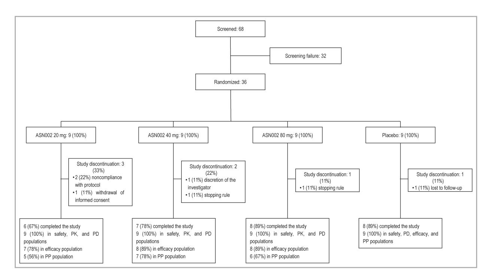
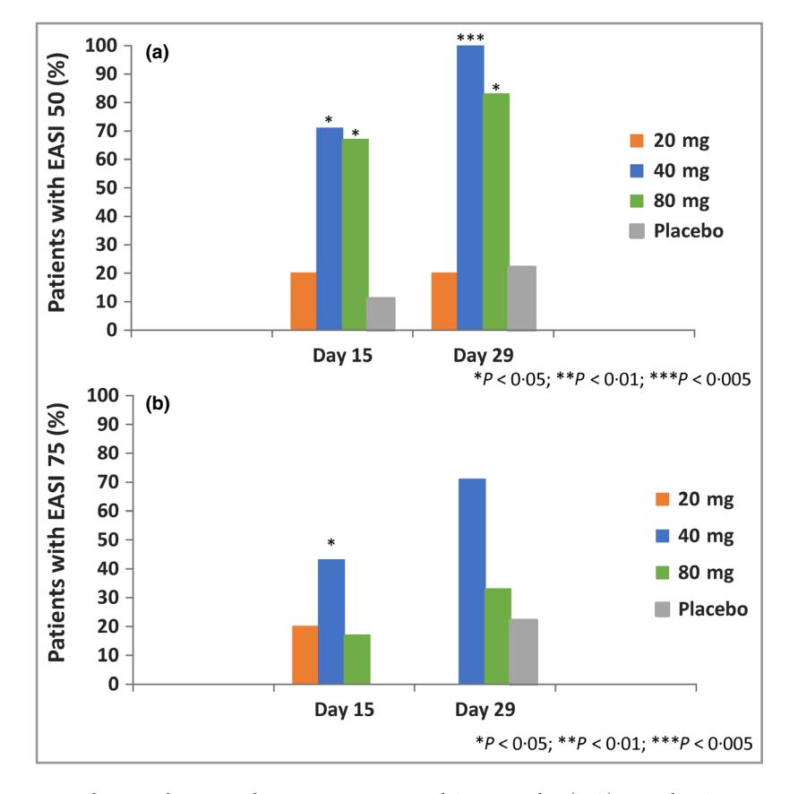
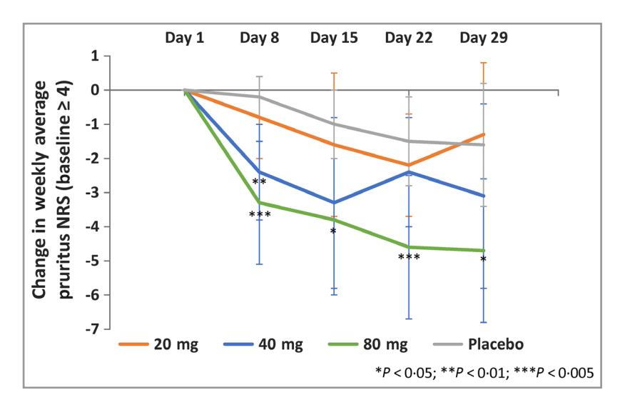
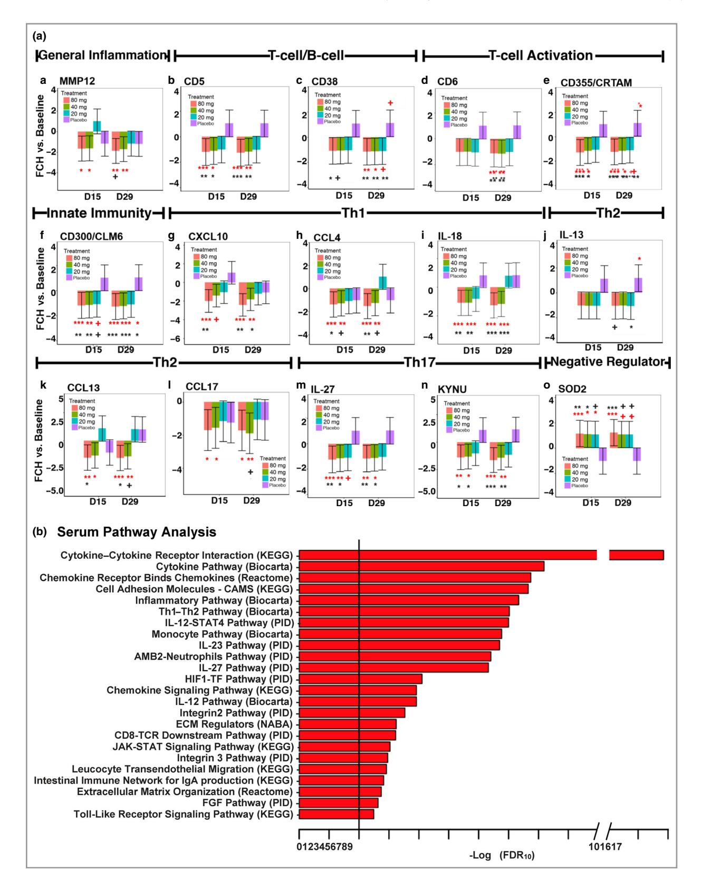

# The oral Janus kinase/spleen tyrosine kinase inhibitor **ASNoo2 demonstrates efficacy and improves associated** systemic inflammation in patients with moderate-to-severe atopic dermatitis: results from a randomized double-blind placebo-controlled study\*

R. Bissonnette 1, C. Maari, S. Forman, N. Bhatia, M. Lee, J. Fowler, S. Tyring, D. Pariser, H. Sofen,

S. Dhawan,9 M. Zook,10 D.J. Zammit,11 H. Usansky,11 L. Denis,11 N. Rao,11 T. Song,12 A.B. Pavel12 and E. Guttman-Yassky 12

1Innovaderm Research Inc., 1851 Sherbrooke Street East, Suite 502, Montreal, H2K 4L5 Quebec, Canada

2Forward Clinical Trials, Inc., 4915 Ehrlich Road, Tampa, 33624 FL, U.S.A.

3Therapeutics Clinical Research, 9025 Balboa Avenue, Suite 105, San Diego, 92123 CA, U.S.A.

4Progressive Clinical Research, P.A., LLC, 1973 North West Loop 410, Suite 106, San Antonio, 78213 TX, U.S.A.

5Dermatology Specialists Research, 3810 Springhurst Boulevard, Suite 130, Louisville, 40241 KY, U.S.A.

6Center for Clinical Studies, University of Texas Health Science Center, 451 North Texas Avenue, Houston, 77598 TX, U.S.A.

7Department of Dermatology, Eastern Virginia Medical School and Virginia Clinical Research Inc., 6160 Kempsville Circle, Suite 200A, Norfolk, 23502 VA,  $U.S.A.$ 

8Dermatology Research Associates, 8930 South Sepulveda Boulevard, Los Angeles, 90045 CA, U.S.A.

9Center for Dermatology Clinical Research Inc., 2557 Mowry Avenue, Suite 21 and 25, Fremont, 94538 CA, U.S.A.

10Olympian Clinical Research, 1201 South Myrtle Avenue, Clearwater, 33756 FL, U.S.A.

11Asana BioSciences, LLC, 997 Lenox Drive, Suite 220, Princeton Pike Corporate Center, Lawrenceville, 08648 NJ, U.S.A.

12Icahn School of Medicine at Mount Sinai, 1425 Madison Avenue, Icahn Building 13-76, New York, 10029 NY, U.S.A.

Linked Comment: Lebwohl. Br J Dermatol 2019; 181:658.

# Summary

### Correspondence

Robert Bissonnette. E-mail: rbissonnette@innovaderm.ca

**Accepted for publication** 

24 March 2019

### **Funding sources**

This study was funded by Asana BioSciences, LLC. The funder has contributed to study design, data analysis and revision of the manuscript.

### **Conflicts of interest**

See Appendix.

\*Plain language summary available online

DOI 10.1111/bjd.17932

Background ASN002 is an oral dual inhibitor of Janus kinase and spleen tyrosine kinase, which are involved in the pathogenesis of atopic dermatitis (AD) through their regulatory role on T helper (Th)1, Th2 and Th17/Th22 pathways.

Objectives The objectives of this study were to evaluate the efficacy, safety, pharmacokinetics and effects on systemic biomarkers of ASN002 in patients with moderate-to-severe AD.

Methods A total of 36 patients with moderate-to-severe AD were randomized (3 : 1) to ASN002 or placebo in the phase Ib study. Three dosage cohorts were studied over a 28-day period (20 mg, 40 mg and 80 mg once daily).

Results ASN002 was superior to placebo for the proportion of patients achieving Eczema Area and Severity Index (EASI) 50 (20 mg 20%,  $P = 0.93$ ; 40 mg 100%,  $P = 0.003$ ; 80 mg 83%,  $P = 0.03$ ; placebo 22%), EASI 75 (20 mg 0%,  $P = 0.27$ ; 40 mg 71%,  $P = 0.06$ ; 80 mg 33%,  $P = 0.65$ ; placebo 22%) and in change from baseline in pruritus (20 mg  $-1.3 \pm 2.1$ , P = 0.81; 40 mg  $-3.1 \pm 2.7$ ,  $P = 0.27$ ; 80 mg  $-4.7 \pm 2.1$ ,  $P = 0.01$ ; placebo  $-1.6 \pm 1.8$ ). Adverse events were generally mild and similar across all groups. ASN002 showed dose-dependent plasma exposure with low interpatient variability, significantly downregulated several serum biomarkers involved in Th1, Th2 and Th17/Th22 immunity, and decreased the atherosclerosis-associated biomarker E selectin/SELE.

Conclusions In patients with moderate-to-severe AD, ASN002 showed strong efficacy with rapid onset of action and associated improvements in systemic inflammation.

© 2019 The Authors. British Journal of Dermatology

British Journal of Dermatology (2019) 181, pp733-742 733

published by John Wiley & Sons Ltd on behalf of British Association of Dermatologists. This is an open access article under the terms of the Creative Commons Attribution-NonCommercial-NoDerivs License, which permits use and distribution in any medium, provided the original work is properly cited, the use is non-commercial and no modifications or adaptations are made.

# What's already known about this topic?

• Currently available therapeutic options for atopic dermatitis (AD) include topical corticosteroids, calcineurin inhibitors, crisaborole, dupilumab, ciclosporin and phototherapy. However, few oral treatments are available and those are associated with safety concerns.

# What does this study add?

- ASN002, an oral, dual Janus kinase and spleen tyrosine kinase inhibitor, was well tolerated and showed promising efficacy and rapid onset of action in patients with moderate-to-severe AD at daily doses of 40 mg and 80 mg.
- The encouraging efficacy, safety and tolerability profile of ASN002 warrant further investigation of ASN002 in patients with moderate-to-severe AD.

Atopic dermatitis (AD) is a chronic inflammatory skin disease with a lifetime prevalence as high as 20%.1 Moderate-tosevere AD is characterized by the presence of eczematous lesions over large surface areas associated with intense pruritus, which can significantly impair quality of life.1–3 Currently available treatments include topical corticosteroids, calcineurin inhibitors and phototherapy, which often have more limited efficacy in patients with extensive disease.4,5 Systemic immune modulators, including ciclosporin, methotrexate, azathioprine and corticosteroids [the only Food and Drug Administration (FDA)-approved oral medication for moderate-to-severe AD in the U.S.A.], can improve AD but their use is limited by longterm toxicity.6,7 Dupilumab, a monoclonal antibody against the interleukin (IL)-4 receptor has recently been approved by the FDA and European Medicines Agency for the treatment of adult patients with moderate-to-severe AD who are candidates for systemic therapies.8–10 However, approximately only 50% of patients with moderate-to-severe AD achieve a reduction of 75% or more in Eczema Area and Severity Index (EASI 75) after 16 weeks of treatment.11 Thus, a high unmet need remains for novel oral treatments with improved efficacy for moderate-to-severe AD.

Spleen tyrosine kinase (SYK) and Janus kinase (JAK) are tyrosine kinases (TYKs) that play important roles in inflammatory processes.12,13 SYK is involved in the release of cytokines during the proinflammatory process, including IL-1b, IL-10 and IL-17,14 and regulates dendritic cells, B lymphocytes and keratinocyte differentiation, suggesting that SYK inhibitors could improve inflammatory skin diseases with aberrant differentiation, such as AD.15 The JAK kinases family (JAK1, JAK2, JAK3 and TYK2) is also involved in signalling pathways of several cytokines involved in AD, such as IL-4, IL-13, IL-31 and IL-33.16–18 In addition, JAK inhibitors, targeting mostly JAK1, have been shown to be effective for the treatment of AD.19–21 ASN002 is a potent, dual inhibitor of JAK and SYK kinases with inhibitory concentration (IC50) values of 5 nmol L1 (SYK), 46 nmol L1 (JAK1), 4 nmol L1 (JAK2), 11 nmol L1 (JAK3) and 8 nmol L1 (TYK2) in biochemical assays.22 The goal of this study was to evaluate the efficacy and safety of ASN002 in patients with moderate-to-severe AD.

# Materials and methods

This randomized, double-blind, placebo-controlled study was conducted at 10 centres in Canada and the U.S.A., from April 2017 to November 2017, and included patients aged 18–75 years with moderate-to-severe AD. Eligible patients were required to have an EASI score of at least 16, an Investigator's Global Assessment (IGA) score of 3 (moderate) or 4 (severe), a body surface area (BSA) involved with AD of at least 10%, and a body mass index ≤ 35 kg m2 at day 1. Washout periods were 1 week for hydroxyzine, diphenhydramine, topical products containing urea and topical antibiotics, 2 weeks for systemic antibiotics and topical medicated treatment for AD, 4 weeks for systemic treatments and 12 weeks or five half-lives (whichever was longer) for biological agents. This study was approved by a research ethics board on 17 March 2017 and written informed consent was obtained from each patient before any study procedure was performed. The trial was registered on ClinicalTrials.gov (NCT03139981).

Three sequential cohorts were enrolled, with doses of 20 mg, 40 mg and 80 mg orally administered once daily for 28 days. In each dosing cohort, 12 patients were randomized in a 3 : 1 ratio to receive ASN002 or placebo according to a central randomization scheme provided by an interactive web response system. Investigators, patients and study site personnel were blinded for treatment assignment. Patients were evaluated at baseline, day 15, day 29 and follow-up for safety, efficacy and serum biomarkers. Safety and pruritus were also evaluated at days 2, 8, 16 and 22.

The primary objective was to evaluate the safety of ASN002 by evaluation of treatment-emergent adverse events (TEAEs). Secondary efficacy end points included the proportion of patients achieving EASI 50, EASI 75 and IGA of 0/1 with at least a two-grade reduction from baseline, and change from baseline in BSA, EASI and single weekly pruritus numeric

© 2019 The Authors. British Journal of Dermatology published by John Wiley & Sons Ltd on behalf of British Association of Dermatologists. rating scale (NRS) over time. Change from baseline in weekly average pruritus NRS for patients with a baseline score of at least 4 was evaluated over time as a post hoc analysis. The pharmacokinetic (PK) end point included evaluations of ASN002 plasma concentrations and PK parameters at day 1 and day 15. Inflammatory markers in serum were evaluated at day 15 and day 29 as an exploratory objective to determine the effect of ASN002 on the disease process.

No formal sample size calculations were performed given the exploratory nature of this study. A study design including 12 patients randomized  $(3 : 1)$  to active treatment or placebo was deemed sufficient to explore the safety and efficacy of ASN002. Demographics and baseline characteristics, in addition to safety and PK data are presented using descriptive statistics. The proportion of patients achieving EASI 50, EASI  $75$  and IGA of  $0\slash 1$  with at least a two-grade reduction from baseline were analysed using the Cochran-Mantel-Haenszel test, in the per-protocol population using nonresponder imputation for missing data. This was the primary analysis proposed in the statistical analysis plan. Change from baseline in EASI, BSA and pruritus NRS were analysed with a mixed-effect model for repeated measures with treatment, visit, and treatment by visit as fixed effects and baseline as a covariate. For the change from baseline end points, a per-protocol analysis with last observation carried forward was used for missing data. Analyses were performed using SAS Version 9.4 (SAS Institute, Inc., Cary, NC, U.S.A.) with a significance level of 0.05. Similar data were obtained when analysing the intentto-treat population (data not shown).

Plasma concentrations of ASN002 were determined using a validated liquid chromatography-tandem mass spectrometry method. PK parameters were determined via noncompartmental analysis.

Serum biomarkers were analysed using OLINK Proseek Multiplex Assay, based on proximity extension assay technology,23-26 and quantified using Fluidigm BioMark™ HD realtime polymerase chain reaction platform.24,27 Biomarkers were analysed using 4 multiplex panels including inflammation I, cardiovascular disease (CVD) II, CVD III, and neuroinflammation, containing a broad array of established and exploratory biomarkers.23 Statistical analysis was performed using R-language Version 3.3.2 (R-project.org). The treatment groups were compared using a linear mixed-effect model with time and treatment as fixed factors, and a random intercept for each patient. A t-test was used for the comparisons, and  $P < 0.05$ was considered for significance. The biomarkers that changed significantly in any treatment groups were combined and compared with the placebo group to increase power. Biomarkers with significant changes between treatment and placebo group were considered for pathway enrichment analysis with XGR software,28 using pathway databases including Kyoto Encyclopedia of Genes and Genomes, Pathway Interaction Database, MSigDB, BioCarta and REACTOME.29-33 The significance cut-off for enriched pathways was the Benjamini-Hochberg false discovery rate  $\leq 0.05$ .

### **Results**

A total of 36 patients were randomized. Patient disposition is presented in Figure 1, and baseline demographics and clinical characteristics are presented in Table 1. The proportion of patients achieving EASI 50 at day 29 was significantly higher for patients receiving ASN002 40 mg (100%,  $P = 0.003$ ) and 80 mg (83%,  $P = 0.03$ ), but not 20 mg (20%,  $P = 0.93$ ), compared with placebo (22%) (Fig. 2a). The proportion of patients achieving EASI 75 at day 29 was higher for patients receiving ASN002 40 mg (71%,  $P = 0.06$ ) and ASN002 80 mg (33%,  $P = 0.65$ ) vs. placebo (22%). None of the patients randomized to ASN002 20 mg achieved EASI 75. At day 15, a significant difference vs. placebo in EASI 75 was observed for patients receiving ASN002 40 mg (43%,  $P = 0.04$ ), but not for those receiving ASN002 20 mg (20%,  $P = 0.18$ ) or ASN002 80 mg (17%,  $P = 0.65$ ) (Fig. 2b). There was also a significant decrease in change from baseline in EASI at day 29 for patients randomized to ASN002 40 mg ( $-17.5 \pm 5.9$ ,  $P = 0.02$ ) and a similar, but not statistically significant, decrease for patients receiving ASN002 80 mg ( $-16.5 \pm 6.8$ ,  $P = 0.17$ ) compared with placebo ( $-7.6 \pm 4.6$ ). ASN002 20 mg (-9.6  $\pm$  16.2, P = 0.64) did not demonstrate a relevant difference from placebo. The proportion of patients achieving an IGA of  $0/1$  with at least a two-grade reduction from baseline at day 29 was 43% ( $P = 0.16$ ) for patients receiving ASN002 40 mg, 17% ( $P = 0.77$ ) for patients receiving ASN002 80 mg, 0% ( $P = 0.46$ ) for patients receiving ASN002 20 mg, and 11% for patients receiving placebo. There was a significant decrease in change from baseline in BSA at day 29 for patients receiving ASN002 40 mg  $(-21.6)$  $\pm$  19.3, P = 0.03) and a similar, but not statistically significant, decrease for patients receiving ASN002 80 mg  $(-22.1$  $\pm$  14.9, P = 0.08) compared with placebo (-3.2  $\pm$  10.9). ASN002 20 mg ( $-9.0 \pm 16.9$ , P = 0.98) did not demonstrate a relevant difference from placebo. There was a significant difference in change from baseline in weekly average pruritus NRS for patients with a baseline score of at least 4 at day 29 for patients receiving ASN002 80 mg ( $-4.7 \pm 2.1$ , P = 0.01) vs. placebo ( $-1.6 \pm 1.8$ ), but the difference was not statistically significant for patients receiving ASN002 40 mg  $(-3.1 \pm 2.7)$ , P = 0.27 and ASN002 20 mg  $(-1.3 \pm 2.1)$ , P  $= 0.81$ ). The difference was also statistically significant at all other days starting from day 8 for patients receiving ASN002 80 mg (Fig. 3). In addition, changes in single weekly pruritus NRS for patients receiving ASN002 were higher vs. placebo as early as day 2 (20 mg  $-1.0 \pm 0.82$ , P = 0.41; 40 mg  $-0.3 \pm 1.03$ , P = 0.24; 80 mg  $-1.0 \pm 2.74$ , P = 0.16; placebo  $0.4 \pm 0.79$ ).

Mean plasma ASN002 concentration at day 1 and day 15 are presented in Figure S1 (see Supporting Information). Systemic ASN002 exposure was generally measurable up to the 24-h time point at all dose levels. A rapid oral absorption and a moderate elimination rate were observed with  $T_{max}$  (time to reach peak plasma concentrations) ranging from 2 h to 4 h,

736 ASN002 demonstrates efficacy and improves inflammation in AD, R. Bissonnette et al.

Fig 1. Consolidated Standards of Reporting Trials diagram. PD, pharmacodynamic (population); PK, pharmacokinetic (population); PP, per protocol (population).

|  |  |  | Table 1 Atopic dermatitis. Baseline demographics and clinical characteristics (safety population) |  |
|--|--|--|---------------------------------------------------------------------------------------------------|--|
|  |  |  |                                                                                                   |  |

|                          | ASN002 20 mg, | ASN002 40 mg, | ASN002 80 mg, | ASN002 Overall, | Placebo,     |
|--------------------------|---------------|---------------|---------------|-----------------|--------------|
|                          | n = 9         | n = 9         | n = 9         | n = 27          | n = 9        |
| Baseline demographics    |               |               |               |                 |              |
| Age, years               | 38.2 ± 14.36  | 42.4 ± 13.88  | 33.1 ± 10.42  | 37.9 ± 13.09    | 29.9 ± 9.33  |
| Sex                      |               |               |               |                 |              |
| Male                     | 5 (56)        | 5 (56)        | 5 (56)        | 15 (56)         | 3 (33)       |
| Female                   | 4 (44)        | 4 (44)        | 4 (44)        | 12 (44)         | 6 (67)       |
| Ethnicity                |               |               |               |                 |              |
| White                    | 6 (67)        | 7 (78)        | 7 (78)        | 20 (74)         | 8 (89)       |
| Black                    | 2 (22)        | 1 (11)        | 2 (22)        | 5 (19)          | 1 (11)       |
| Asian                    | 0 (0.0)       | 1 (11)        | 0 (0)         | 1 (4)           | 0 (0)        |
| Other                    | 1 (11)        | 0 (0)         | 0 (0)         | 1 (4)           | 0 (0)        |
| Weight at screening, kg  | 76.3 ± 11.65  | 72.3 ± 11.46  | 85.4 ± 16.23  | 78.0 ± 13.94    | 72.3 ± 15.11 |
| Height at screening, cm  | 169.1 ± 5.57  | 165.0 ± 8.45  | 174.0 ± 6.22  | 169.4 ± 7.59    | 165.0 ± 9.82 |
| BMI at screening, kg m-2 | 26.8 ± 4.92   | 26.6 ± 3.87   | 28.2 ± 5.44   | 27.2 ± 4.66     | 26.5 ± 4.75  |
| Clinical characteristics |               |               |               |                 |              |
| EASI score               | 29.0 ± 13.49  | 21.8 ± 6.21   | 28.2 ± 11.67  | 26.3 ± 10.97    | 21.6 ± 6.24  |
| IGA score                |               |               |               |                 |              |
| 3 (Moderate)             | 5 (56)        | 8 (89)        | 4 (44)        | 17 (63)         | 8 (89)       |
| 4 (Severe)               | 4 (44)        | 1 (11)        | 5 (56)        | 10 (37)         | 1 (11)       |
| BSA                      | 44.1 ± 20.19  | 31.4 ± 17.96  | 36.9 ± 25.88  | 37.5 ± 21.42    | 25.1 ± 10.49 |
| Pruritus NRS             | 5.4 ± 2.26    | 6.1 ± 2.47    | 6.0 ± 2.55    | 5.8 ± 2.36      | 5.9 ± 2.57   |

Data are presented as mean SD or n (%). BMI, body mass index; BSA, body surface area; EASI, Eczema Area and Severity Index; IGA, Investigator's Global Assessment; NRS, numeric rating scale.

and mean terminal half-life (t1/2) ranging from 73 to 141 at steady state. Maximum observed concentration (Cmax) and area under the plasma concentration (AUC) parameters showed dose-dependent exposure, and AUC approximately proportional to the increase of dose (Table S1; see Supporting Information). Interpatient variability in Cmax and AUC was low to moderate, and minimal drug accumulation was measured at steady state.

Fig 2. Proportion of patients with atopic dermatits achieving Eczema Area and Severity Index (EASI) 50 and EASI 75 over time. (a) Proportion of patients achieving EASI 50 over time. (b) Proportion of patients achieving EASI 75 over time. The proportion of patients achieving EASI 50 and EASI 75 were analysed using a Cochran–Mantel–Haenszel test, in the per-protocol population using nonresponder imputation for missing data.

Fig 3. Atopic dermatitis. Change from baseline in weekly average pruritus numeric rating scale (NRS) for patients with a baseline of at least 4. Change from baseline in weekly average pruritus NRS for patients with a baseline of at least 4 over time. Changes from baseline were analysed with a mixed-effect model for repeated measures with treatment, visit, and treatment by visit as fixed effects and baseline as a covariate. A perprotocol analysis with last observation carried forward was used for missing data.

A summary of TEAEs occurring in at least two patients per treatment group and events meeting the stopping rules is presented in Table 2. Overall, TEAEs were similar across all groups, including placebo. There were two events meeting the stopping rule, i.e. mild hypertension and low lymphocyte counts. The event of mild hypertension was reported in a

|                                   | ASN002 20 mg (n = 9) | ASN002 40 mg (n = 9) | ASN002 80 mg (n = 9) | ASN002 overall (n = 27) | Placebo (n = 9) |
|-----------------------------------|-------------------------|-------------------------|-------------------------|----------------------------|--------------------|
| Treatment-emergent adverse events |                         |                         |                         |                            |                    |
| Headache                          | 1 (11)                  | 4 (44)                  | 2 (22)                  | 7 (26)                     | 3 (33)             |
| Nausea                            | 0 (0)                   | 1 (11)                  | 4 (44)                  | 5 (19)                     | 2 (22)             |
| Diarrhoea                         | 0 (0)                   | 1 (11)                  | 2 (22)                  | 3 (11)                     | 1 (11)             |
| Nasopharyngitis                   | 2 (22)                  | 1 (11)                  | 0 (0)                   | 3 (11)                     | 1 (11)             |
| Back pain                         | 0 (0)                   | 2 (22)                  | 0 (0)                   | 2 (7)                      | 0 (0)              |
| Events meeting the stopping rules |                         |                         |                         |                            |                    |
| Mild hypertension                 | 0 (0)                   | 0 (0)                   | 1 (11)                  | 1 (4)                      | 0 (0)              |
| Low lymphocytes levels            | 0 (0)                   | 1 (11)                  | 0 (0)                   | 1 (4)                      | 0 (0)              |

Table 2 Summary of treatment-emergent adverse events occurring in at least two patients with atopic dermatitis per treatment group and events meeting the stopping rules

patient receiving ASN002 80 mg, and was classified as a possibly related TEAE. The event of lymphopenia was reported in a patient who had predose lymphocyte levels of 067 9 103 lL1 at day 1 and 056 9 103 lL1 at day 8. There was one serious adverse event of anxiety attack reported in a patient from the ASN002 80 mg group. This event occurred after the treatment period and was evaluated by the investigator as not related to the treatment. No clinically significant changes in lipid profile and vital signs were observed.

ASN002 induced significant, and progressive reductions in the AD inflammatory serum signature,26,34 which was particularly evident at the higher doses (Figs 4a, S2, Table S2; see Supporting Information). Among the highly and/or significantly downregulated markers, are products of general inflammation (MMP12, TRAIL), innate immunity (CD300/CLM6, MARCO/macrophage receptor with collagenous structure, CD163/macrophage scavenger receptor), T cell/B cell (CD5, CD38), T-cell activation (CD6, IL-16, IL-2RA, CD355/ CRTAM, AXL, CCL19, CD137/TNFRSF9), Th1 (CXCL10/ CXCL11/CXCL9, CCL4, IL-18, IL-12B/IL12/23p40), Th2 (IL-13, CCL13, CCL17), Th17 (IL-27, KYNU/kynureninase, CD318/CDCP1) and related markers. ASN002 also induced significant increases in negative regulator products (SOD2, PON3) (Figs 4a, S2; see Supporting Information). At day 15, many markers already showed significant treatment effects with ASN002 vs. placebo, predominantly at 40 mg and 80 mg (CD5, CD300/CLM6, CXCL10, CCL4, IL-18, IL-12B/IL- 12/23p40, CCL13, IL-27, KYNU, SOD2 and others). Similar or more significant modulations were observed at day 29. Among the downregulated markers with ASN002 were atherosclerosis mediators, such as E selectin/SELE, recently shown to be upregulated in AD (Table S2; see Supporting Information).26 An enrichment analysis based on several wellestablished databases was also conducted to identify the pathways most significantly modulated in patients treated with ASN002, compared with baseline (Table S3; see Supporting Information) and patients treated with placebo at day 29 (Fig. 4b). All doses were grouped together owing to the small sample size. The most significantly enriched pathways impacted by JAK/SYK were cytokine–cytokine-receptor interaction, cytokine, Th1–Th2, inflammatory, chemokine-receptor binding, chemokine signalling, JAK-STAT signalling and IL-23 pathways.

# Discussion

This proof of concept study showed that ASN002, at oral dosages of 40 mg and 80 mg, once daily was effective at improving signs and symptoms of AD and was well tolerated. At both dosages, the efficacy was consistently higher than placebo and most of the efficacy end points achieved statistical significance. However, ASN002 20 mg did not show significant differences in efficacy compared with placebo. The small effect size observed with 20 mg suggests that this dosage may

Fig 4. Changes in serum protein levels with ASN002 treatment and patients with atopic dermatitis treated with placebo. (a) Box plots depict mean fold changes (FCHs) from baseline at day 15 and day 29. Significant reduction was seen in serum levels of markers of general inflammation (a), T-cell/B-cell markers (b, c), T-cell activation (d, e), innate immunity (f), T helper (Th)1 axis (g–i), Th2 axis (i–l), Th17 axis (m, n), and negative regulator (o). Red stars denote significance vs. baseline in respective groups, whereas black stars identify significant changes in respective drug groups compared with placebo group. The treatment groups were compared using a linear mixed-effect model with time and treatment as fixed factors, and a random intercept for each patient. The t-test was used for the comparisons. +P &lt; 01, \*P &lt; 005, \*\*P &lt; 001, \*\*\*P &lt; 0001. (b) Pathway analyses. Pathways significantly enriched in serum of patients treated with study drug vs. patients treated placebo at day 29 compared with baseline. All patients treated with the study drug regardless of dosage were grouped together owing to the small patient number. The pathways are ordered by significance, with the black line representing false discovery rate (FDR) < 005. The significance cut-off for enriched pathways was the Benjamini–Hochberg false discovery rate < 005. KEGG, Kyoto Encyclopedia of Genes and Genomes; PID, Pathway Interaction Database; Th, T helper; IL, interleukin; HIF1-TF, hypoxia-inducible factor 1 transcription factor; ECM, extracellular matrix; FGF, fibroblast growth factor. JAK, Janus kinase; STAT, signal transducers and activators of transcription.

be lower than the minimum effective dosage. In general, improved efficacy outcomes were observed with the 40-mg dosage compared with the 80-mg dosage. Further studies are needed to see whether this is related to the small sample size and baseline differences between groups observed in the current study. Notably, a rapid onset of action on pruritus was

published by John Wiley & Sons Ltd on behalf of British Association of Dermatologists.

observed as early as day 2 with a statistically significant decrease on day 8 for ASN002 80 mg. Early and rapid decrease in pruritus has been reported with topical and systemic JAK inhibitors and could be related to the inhibition of the IL-31 signalling pathway.35 After only 4 weeks of treatment with ASN002 at 40 mg, 100% of patients achieved EASI 50 and 71% achieved EASI 75.

Several cytokines including Th1/interferon-c, Th2/IL-4, IL-13, IL-31, IL-33, IL-5, Th17/Th22/IL-17 and IL-22 have been shown to be increased in AD, suggesting the possible involvement of Th1, Th2 and Th17 pathways in disease pathogenesis.16–18 Moreover, the relative role of these pathways varies with age and ethnicity.3,36–39 For example, Th17 activation has been shown to be higher in children and Asian patients.36,39 SYK is involved in several cytokine signalling pathways, including the Th17 pathway.14 It induces the production of CCL20, which attracts Th17 cells to the skin.15 SYK also acts as a negative regulator of keratinocyte differentiation, and gradually decreases during the terminal differentiation process owing to a cross-regulation with epidermal growth factor receptor.15 In addition, SYK is involved in the survival, proliferation, and activation of B lymphocytes and in differentiation of dendritic cells.40,41 Therefore, combining SYK with JAK inhibition could provide additional clinical benefits in the treatment of AD.

Based on serum biomarker analyses, our study showed that ASN002 provided greater and more significant modulation of many key AD circulatory biomarkers compared with placebo, particularly at high dosages.26 Many established AD biomarkers, including inflammatory measures (MMP12, TRAIL), or Th1/CXCL10-, Th2/CCL17- and CCL13-related products, were significantly downregulated only with ASN002, and the negative regulators SOD2 and PON3, which have possible protective anti-inflammatory and anti-oxidant properties,42,43 were upregulated. Interestingly, serum markers associated with atherosclerosis were downregulated by ASN002, including Eselectin/SELE,24,26 possibly suggesting that effective AD therapy may have the potential to reduce cardiovascular risk in patients with AD. There was also a significant difference in expression of B-cell-associated products (CD5, CD38, CD137, IL-16, CD300), suggesting that ASN002 also has effects on B lymphocytes. While these analyses were intended to compare the effects of ASN002 on serum biomarkers with the placebo, it is important to note that the measured changes may not be associated with clinical response to ASN002. Despite this limitation, the present study uncovered that ASN002 has a robust effect on multiple inflammatory pathways compared with placebo, including those related to cytokine/chemokine, JAK-STAT, SYK and Th1/Th2/Th17 signalling.

In the current trial, ASN002 at both 40 mg and 80 mg showed good evidence of activity, but efficacy was generally higher for ASN002 40 mg. The difference in response between 40 mg and 80 mg could be related to the small size of the current study or to differences in baseline characteristics between the groups. There were demographic differences between groups with higher baseline EASI, BSA, proportion of patients with severe disease, and mean weight (difference of 131 kg) in the 80-mg group compared to the 40-mg group. The difference is probably not related to patient adherence as PK analysis showed clear dose-dependent increases in plasma levels after oral administration of ASN002.

Overall, ASN002 demonstrated statistically significant efficacy in treatment of AD, with a rapid improvement in key parameters of clinical efficacy and inflammation, despite the small sample size and short treatment duration. ASN002 was well tolerated at all tested dosages, with no obvious relationship between dosage and incidence of TEAEs. The safety profile of ASN002 was also consistent with that expected upon dual inhibition of JAK and SYK.44,45 However, the conclusions on safety are limited by the small number of patients in each treatment group. No serious infections, tuberculosis, opportunistic infections, thrombocytopenia, thromboembolic events, changes in cholesterol or effect on blood pressure were observed. Collectively, these data support further development of ASN002 in the treatment of AD and beyond.

# Acknowledgments

We want to thank Altasciences Clinical Research for the statistical analysis, Sarper Toker for his assistance in the safety review process and Lucile Sinck for her assistance in medical writing.

# References

- 1 Weidinger S, Novak N. Atopic dermatitis. Lancet 2016; 387:1109– 22.
- 2 Eichenfield LF, Tom WL, Chamlin SL et al. Guidelines of care for the management of atopic dermatitis: section 1. Diagnosis and assessment of atopic dermatitis. J Am Acad Dermatol 2014; 70:338– 51.
- 3 Kaufman BP, Guttman-Yassky E, Alexis AF. Atopic dermatitis in diverse racial and ethnic groups-variations in epidemiology, genetics, clinical presentation and treatment. Exp Dermatol 2018; 27:340– 57.
- 4 Papier A, Strowd LC. Atopic dermatitis: a review of topical nonsteroid therapy. Drugs Context 2018; 7:212521.
- 5 Patrizi A, Raone B, Ravaioli GM. Safety and efficacy of phototherapy in the management of eczema. Adv Exp Med Biol 2017; 996:319–31.
- 6 Sidbury R, Davis DM, Cohen DE et al. Guidelines of care for the management of atopic dermatitis: section 3. Management and treatment with phototherapy and systemic agents. J Am Acad Dermatol 2014; 71:327–49.
- 7 Renert-Yuval Y, Guttman-Yassky E. Systemic therapies in atopic dermatitis: the pipeline. Clin Dermatol 2017; 35:387–97.
- 8 Hamilton JD, Ungar B, Guttman-Yassky E. Drug evaluation review: dupilumab in atopic dermatitis. Immunotherapy 2015; 7:1043–58.
- 9 Dupixent [prescribing information]. Tarrytown, NY: Regeneron Pharmaceuticals, Inc., 2018.
- 10 Dupixent [summary of product characteristics]. Paris: Sanofi Winthrop Industrie, 2018.
- 11 Simpson EL, Bieber T, Guttman-Yassky E et al. Two phase 3 trials of dupilumab versus placebo in atopic dermatitis. N Engl J Med 2016; 375:2335–48.

- 12 Riccaboni M, Bianchi I, Petrillo P. Spleen tyrosine kinases: biology, therapeutic targets and drugs. Drug Discov Today 2010; 15:517–30.
- 13 Pesu M, Laurence A, Kishore N et al. Therapeutic targeting of Janus kinases. Immunol Rev 2008; 223:132–42.
- 14 Patel D, Gaikwad S, Challagundla N et al. Spleen tyrosine kinase inhibition ameliorates airway inflammation through modulation of NLRP3 inflammosome and Th17/Treg axis. Int Immunopharmacol 2018; 54:375–84.
- 15 Wu NL, Huang DY, Wang LF et al. Spleen tyrosine kinase mediates EGFR signaling to regulate keratinocyte terminal differentiation. J Invest Dermatol 2016; 136:192–201.
- 16 Ihle JN. The Janus protein tyrosine kinase family and its role in cytokine signaling. Adv Immunol 1995; 60:1–35.
- 17 Vainchenker W, Dusa A, Constantinescu SN. JAKs in pathology: role of Janus kinases in hematopoietic malignancies and immunodeficiencies. Semin Cell Dev Biol 2008; 19:385–93.
- 18 Shan J, Oshima T, Wu L et al. Interferon c-induced nuclear interleukin-33 potentiates the release of esophageal epithelial derived cytokines. PLOS ONE 2016; 11:e0151701.
- 19 Bissonnette R. JAK inhibitors appear to have a bright future in the treatment of atopic dermatitis. Br J Dermatol 2018; 178:321.
- 20 Tanimoto A, Shinozaki Y, Yamamoto Y et al. A novel JAK inhibitor JTE-052 reduces skin inflammation and ameliorates chronic dermatitis in rodent models: comparison with conventional therapeutic agents. Exp Dermatol 2018; 27:22–9.
- 21 Guttman-Yassky E, Silverberg JI, Nemoto O et al. Baricitinib in adult patients with moderate-to-severe atopic dermatitis: a phase 2 parallel, double-blinded, randomized placebo-controlled multipledose study. J Am Acad Dermatol 2018; 80:e9.
- 22 Zammit D, Reddy S, Smith R, Damle N, Gupta S. ASN002, a novel dual SYK/JAK inhibitor, demonstrates strong efficacy in a rat model of collagen-induced arthritis [abstract]. Arthritis Rheumatol 2017; 69 (Suppl. 10): abstr. 1337.
- 23 Assarsson E, Lundberg M, Holmquist G et al. Homogenous 96-plex PEA immunoassay exhibiting high sensitivity, specificity, and excellent scalability. PLOS ONE 2014; 9:e95192.
- 24 Lind L, Arnlov J, Lindahl B et al. Use of a proximity extension assay proteomics chip to discover new biomarkers for human atherosclerosis. Atherosclerosis 2015; 242:205–10.
- 25 Soderlund S, Christiansson L, Persson I et al. Plasma proteomics in CML patients before and after initiation of tyrosine kinase inhibitor therapy reveals induced Th1 immunity and loss of angiogenic stimuli. Leuk Res 2016; 50:95–103.
- 26 Brunner PM, Suarez-Farinas M, He H et al. The atopic dermatitis blood signature is characterized by increases in inflammatory and cardiovascular risk proteins. Sci Rep 2017; 7:8707.
- 27 Carlsson AC, Sundstrom J, Carrero JJ et al. Use of a proximity extension assay proteomics chip to discover new biomarkers associated with albuminuria. Eur J Prev Cardiol 2017; 24:340–8.
- 28 Fang H, Knezevic B, Burnham KL, Knight JC. XGR software for enhanced interpretation of genomic summary data, illustrated by application to immunological traits. Genome Med 2016; 8:129.
- 29 Chen L, Chu C, Lu J et al. Gene ontology and KEGG pathway enrichment analysis of a drug target-based classification system. PLOS ONE 2015; 10:e0126492.
- 30 Schaefer CF, Anthony K, Krupa S et al. PID: the pathway interaction database. Nucleic Acids Res 2009; 37:D674–9.
- 31 Naba A, Clauser KR, Ding H et al. The extracellular matrix: tools and insights for the "omics" era. Matrix Biol 2016; 49:10–24.
- 32 Li X, Liang L, De Vivo I et al. Pathway analysis of expressionrelated SNPs on genome-wide association study of basal cell carcinoma. Oncotarget 2016; 7:36885–95.

- 33 Croft D, Mundo AF, Haw R et al. The Reactome pathway Knowledgebase. Nucleic Acids Res 2014; 42:D472–7.
- 34 Mansouri Y, Guttman-Yassky E. Immune pathways in atopic dermatitis, and definition of biomarkers through broad and targeted therapeutics. J Clin Med 2015; 4:858–73.
- 35 Cornelissen C, Luscher-Firzlaff J, Baron JM, Luscher B. Signaling by IL-31 and functional consequences. Eur J Cell Biol 2012; 91:552–66.
- 36 Brunner PM, Israel A, Zhang N et al. Early-onset pediatric atopic dermatitis is characterized by TH2/TH17/TH22-centered inflammation and lipid alterations. J Allergy Clin Immunol 2018; 141:2094–106.
- 37 Czarnowicki T, Esaki H, Gonzalez J et al. Alterations in B-cell subsets in pediatric patients with early atopic dermatitis. J Allergy Clin Immunol 2017; 140:e9.
- 38 Esaki H, Brunner PM, Renert-Yuval Y et al. Early-onset pediatric atopic dermatitis is TH2 but also TH17 polarized in skin. J Allergy Clin Immunol 2016; 138:1639–51.
- 39 Noda S, Suarez-Farinas M, Ungar B et al. The Asian atopic dermatitis phenotype combines features of atopic dermatitis and psoriasis with increased TH17 polarization. J Allergy Clin Immunol 2015; 136:125–64.
- 40 Schweighoffer E, Nys J, Vanes L et al. TLR4 signals in B lymphocytes are transduced via the B cell antigen receptor and SYK. J Exp Med 2017; 214:1269–80.
- 41 Benito-Villalvilla C, Cirauqui C, Diez-Rivero CM et al. MV140, a sublingual polyvalent bacterial preparation to treat recurrent urinary tract infections, licenses human dendritic cells for generating Th1, Th17, and IL-10 responses via Syk and MyD88. Mucosal Immunol 2017; 10:924–35.
- 42 Traba J, Geiger SS, Kwarteng-Siaw M et al. Prolonged fasting suppresses mitochondrial NLRP3 inflammasome assembly and activation via SIRT3-mediated activation of superoxide dismutase 2. J Biol Chem 2017; 292:12153–64.
- 43 Borovkova EI, Antipova NV, Komeenko TV et al. [Paraoxonase: the universal factor of antioxidant defense in human body]. Vestn Ross Akad Med Nauk 2017; 72:5–10 (in Russian).
- 44 He H, Guttman-Yassky E. JAK inhibitors for atopic dermatitis: an update. Am J Clin Dermatol 2018; in press.
- 45 Weinblatt ME, Kavanaugh A, Genovese MC et al. An oral spleen tyrosine kinase (Syk) inhibitor for rheumatoid arthritis. N Engl J Med 2010; 363:1303–12.

# Appendix

# Conflicts of interest

R.B. is an investigator, consultant, advisory board member, speaker for and/or receives honoraria from Aquinox Pharma, AntibioTx, Asana BioSciences, Astellas, Brickell Biotech, Dermavant, Dermira, Dignity Sciences, Galderma, Glenmark, GSK Stiefel, Hoffman LaRoche Posay, Kiniksa, Leo Pharma, Neokera, Pfizer, Regeneron, Sienna and Vitae. R.B. is also a shareholder of Innovaderm Research. C.M. has received grants and research support or received honoraria from Aquinox Pharma, Asana BioScience, Astellas, Brickell Biotech, Dermavant, Lilly Pharma, Galderma, Glenmark, GSK Stiefel, Hoffman LaRoche Posay, Leo Pharma, Pfizer, Regeneron-Sanofi, Vitae and Valeant. S.F. has received grants and research support or received honoraria from AbbVie, Janssen, Eli Lilly, Novartis,

Pfizer, Xbiotech, Galderma, Asana BioSciences and Regeneron. N.B. has received grants and research support from Asana BioSciences. M.L. has received grants and research support from AbbVie, Boehringer Ingelheim, Novartis, Lilly, Janssen, Leo Pharmaceuticals, Dermira, UCB, Aclaris, Valeant and Asana BioSciences. J.F. has received grants and research support from Asana BioSciences. S.T. has received grants and research support from Asana BioSciences. D.P. is an investigator, consultant, advisory board member, speaker for and/or receives honoraria from Abbott Laboratories, Amgen, Asana BioSciences, Atacama Therapeutics, Bickel Biotechnology, Biofrontera AG, Celgene Corporation, Dermira, Dermavant Sciences, DUSA Pharmaceuticals, Inc., Eli Lilly, GSK Stiefel, Leo Pharma, Merck, Novartis Pharmaceuticals Corp., Novo Nordisk A/S, Ortho Dermatologics, Peplin Inc., Pfizer Inc., Photocure ASA, Promius Pharmaceuticals, Regeneron, Sanofi, TDM Surgitech, Inc., TheraVida and Valeant. H.S. has received grants and research support or received honoraria from Dermira, Leo Pharma, Ralexar, Incyte, Dermavant, Lilly, Regeneron, Genentech and Asana BioSciences. S.D. has received grants and research support from AbbVie, Allergan, Asana BioSciences, Dermira, Galderma, GSK Stiefel, Leo Pharma, Revance and Valeant. M.Z. has received grants and research support from Pfizer, Novartis, Sienna, Janssen, Endo International, Lilly, Dermira, Moberg Pharma, Soligenix, Allergan, Asana BioSciences, Athenex, Foamix, Incyte, Sun Pharma and Verrice. D.J.Z., H.U., L.D. N.R. are employees of Asana BioSciences. E.G.-Y. is an employee of Mount Sinai and has received research funds (grants paid to the institution) from AbbVie, Celgene, Eli Lilly, Novan, Relaxar, Janssen, Novartis, Pfizer, Regeneron, Glenmark, Dermavent, DBV, DS Biopharma, Concert, Galderma, Asana, Innovaderm, and Dermira. Emma Guttman-Yassky is also a consultant for Amgen, Sanofi Aventis, Escallier, Allergan, Regeneron, Celgene, Dermira, Galderma, Glenmark, Novartis, Pfizer, Leo Pharma, AbbVie, Eli Lilly, Kyowa, Mitsubishi Tanabe and Asana BioSciences.

# Supporting Information

Additional Supporting Information may be found in the online version of this article at the publisher's website:

Fig S1. Mean plasma concentration of ASN002 at day 1 and day 15.

Fig S2. Box plots depicting serum chemokine/cytokines mean fold change (FCH) from baseline in patients with atopic dermatitis in treatment groups of 80 mg, 40 mg, 20 mg, and placebo at two time points of day 15 and day 29.

Table S1 Summary of pharmacokinetics parameters of ASN002 in patients with atopic dermatitis (AD) following once daily oral administration.

Table S2 OLINK data per gene with corresponding protein in each treatment group at specific time points with significance by P-values and false discovery rates (FDR) adjusted Pvalues.

Table S3 Pathway enrichment analysis based on databases including Kyoto Encyclopedia of Genes and Genomes (KEGG), Reactome Pathway Database, BioCarta, Pathway Interaction Database (PID) and MSigDB.

Powerpoint S1 Journal Club Slide Set. Video S1 Author video.